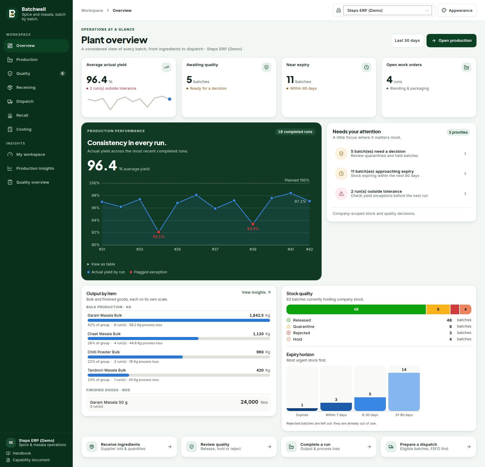
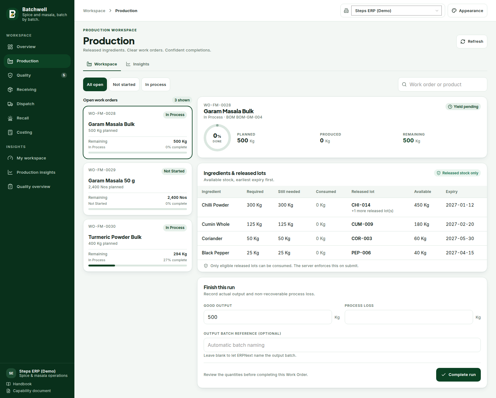
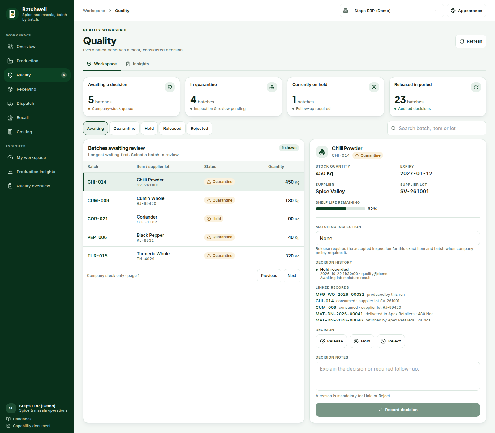
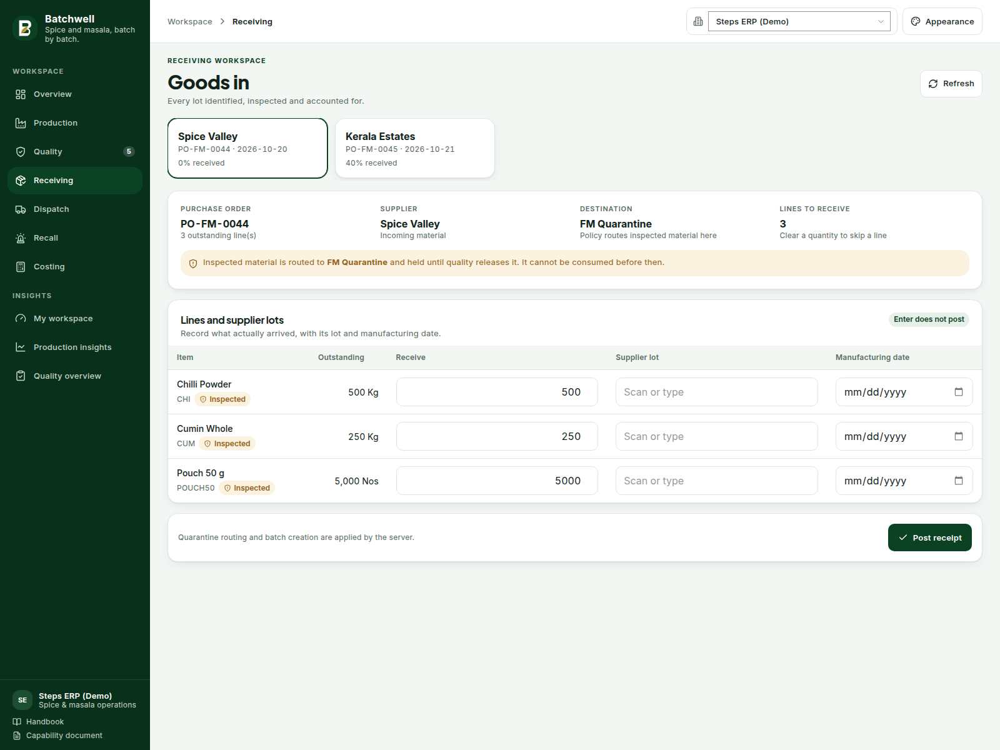
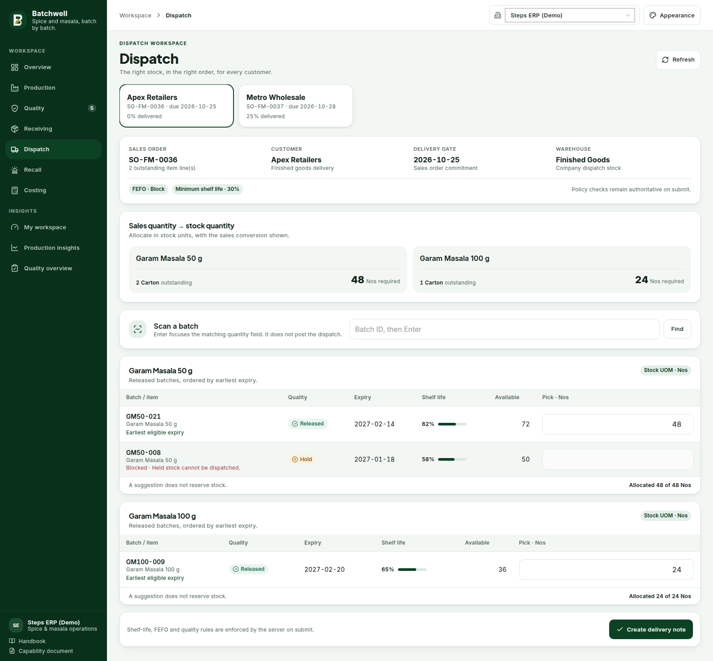
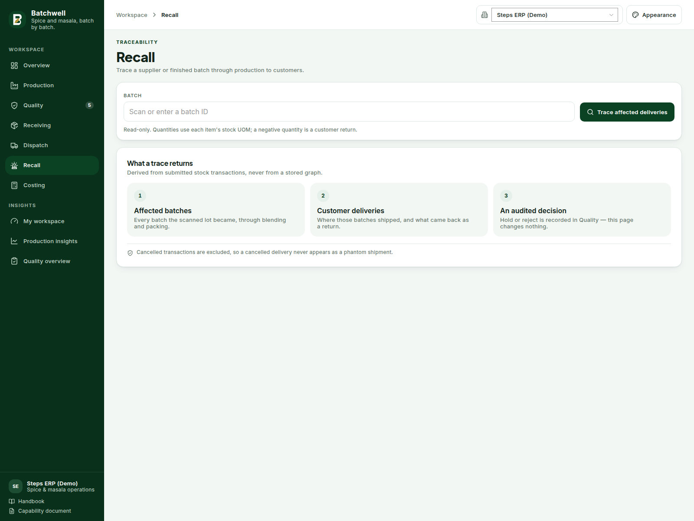
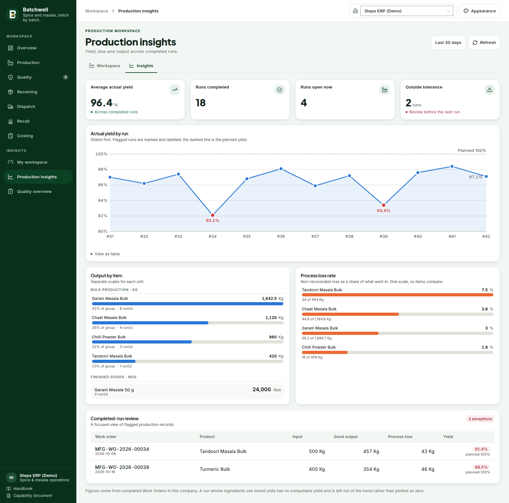
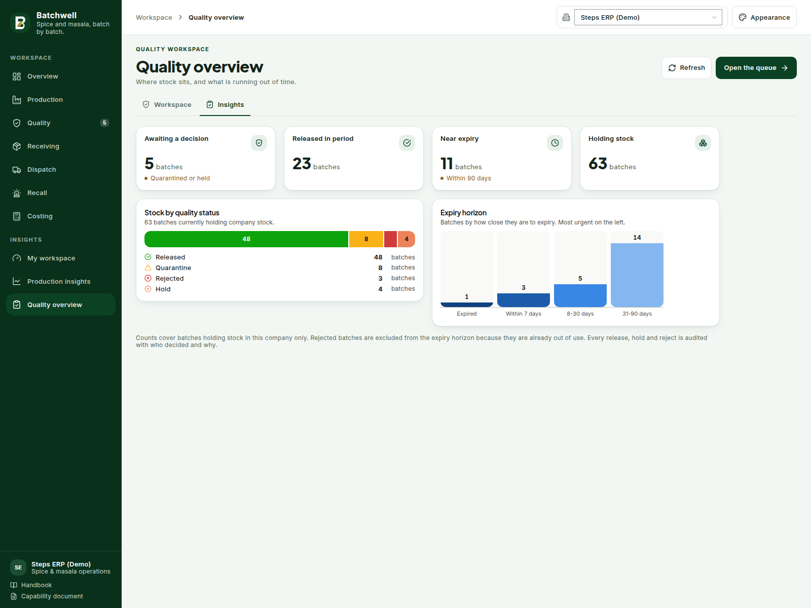
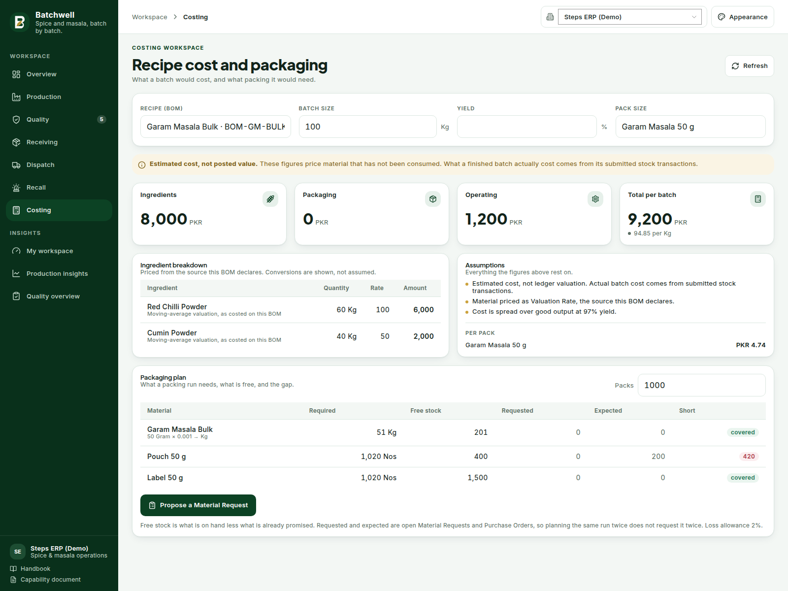
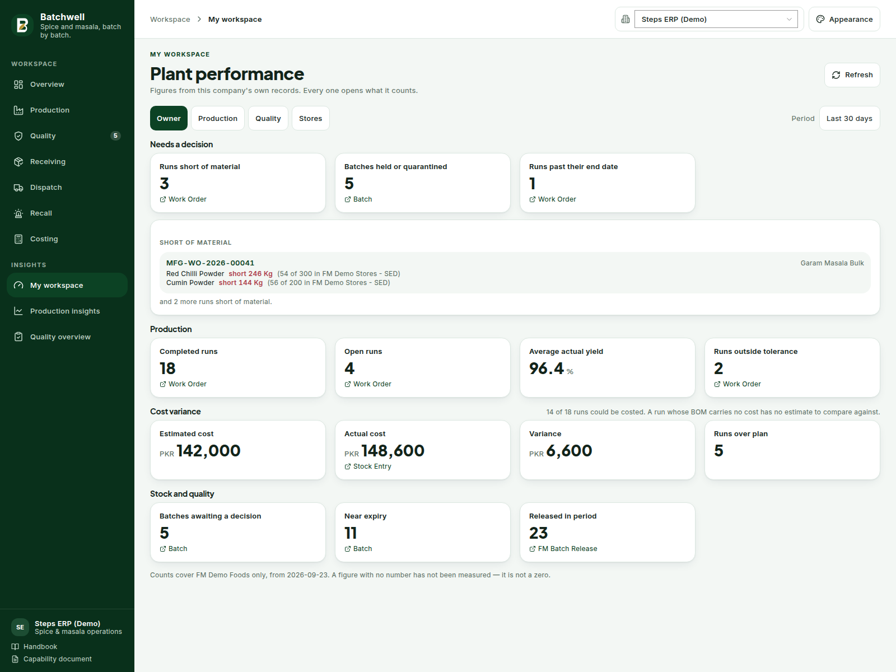

<div align="center">

# 🌶️ Food Manufacturing for ERPNext

### Open-source food manufacturing solution built on Frappe & ERPNext.

Manage spice production, quality control, batch traceability,
recipe-based blending, packaging and dispatch in one integrated workflow.

[Features](#what-it-does) ·
[Installation](#install) ·
[Screenshots](#the-operator-console) ·
[Documentation](#documentation)

</div>

---

## Why Food Manufacturing?

ERPNext provides the foundation for purchasing, inventory,
manufacturing and sales. This app adds the specialized controls
needed by food and spice manufacturers.

- **Quality Control:** Quarantine, Released, Hold and Rejected batches.
- **Batch Traceability:** Trace supplier lots through production to customers.
- **FEFO:** Prioritize stock by earliest expiry.
- **Shelf-Life Management:** Prevent dispatch of expired or ineligible stock.
- **Recipe Management:** Protect confidential ingredient percentages.
- **Production Yield:** Track actual output and process loss.
- **Packaging:** Convert bulk blends into multiple finished pack sizes.

> Start with the built-in handbook at `/handbook` after installation.
> It includes operating, administrator and developer guides.

---

## Contents

- [What it does](#what-it-does)
- [Install](#install)
- [Set up a company](#set-up-a-company)
- [Set up your items](#set-up-your-items)
- [Write a recipe](#write-a-recipe)
- [The daily round](#the-daily-round)
- [The operator console](#the-operator-console)
- [Roles](#roles)
- [Demo data](#demo-data)
- [Developing](#developing)
- [Troubleshooting](#troubleshooting)

---

## What it does

Five rules ERPNext does not enforce on its own, applied on the server so they
hold for the Desk, the API and Data Import alike:

| Rule | What it means |
|---|---|
| **Quality gate** | A batch is Quarantine, Released, Hold or Rejected. Only Released stock can be consumed in production or dispatched. |
| **Shelf life** | A batch below the company's minimum remaining shelf life cannot be dispatched; expired stock is blocked outright. |
| **FEFO** | Dispatch suggests the earliest-expiring eligible batch, and can warn or block when you pick out of order. |
| **Yield** | Every run records actual output and non-recoverable process loss, and flags runs outside tolerance. |
| **Traceability** | A supplier lot can be traced forward to every batch it became and every delivery it reached — and back again. |

Recipes are confidential: ingredient percentages sit behind `permlevel` 1, so an
operator who runs a blend never sees the formula.

## Install

Requires **Frappe v16 and ERPNext v16** on the same major version.

```bash
cd ~/frappe-bench
bench get-app https://github.com/irfanzahoor/fmc --branch version-16
bench --site <your-site> install-app food_manufacturing
bench --site <your-site> migrate
bench build --app food_manufacturing
```

The install creates the six FM roles, 30 custom fields on standard DocTypes and
four module definitions. It is safe to re-run.

## Set up a company

Nothing works until the company has a policy — the console will tell you so, and
mark the company "not set up" in its switcher.

**FM Manufacturing Policy** (one per company, named after it):

| Field | Default | What it controls |
|---|---|---|
| `quarantine_warehouse` | — *(required)* | Where incoming stock lands before it is cleared |
| `rejected_warehouse` | — *(required)* | Where rejected batches are moved |
| `bulk_warehouse`, `packaging_warehouse`, `finished_goods_warehouse` | — | Defaults the console offers |
| `require_incoming_inspection` | on | Receipts route to quarantine instead of stores |
| `block_unreleased_consumption` | on | A run cannot consume a batch that is not Released |
| `block_rejected_consumption` | on | A rejected batch can never be consumed |
| `min_remaining_shelf_life_percent` | 25 | Dispatch floor, as a share of total shelf life |
| `near_expiry_alert_days` | 30 | Horizon for the daily near-expiry email |
| `block_expired_dispatch` | on | Expired stock cannot leave |
| `enforce_fefo` | `Warn` | `Off`, `Warn` or `Block` when picking out of expiry order |
| `yield_variance_tolerance_percent` | 2 | Beyond this, a run is flagged for review |

Set `enabled` off to retire a company without deleting its history.

## Set up your items

Each stock item carries a **Material Nature**, which is what the rules key off:

| Nature | Batch-tracked | Used for |
|---|---|---|
| `Raw Material` | yes | Spices, salt, oils — anything received and inspected |
| `Packaging Material` | no | Pouches, cartons, labels — counted, not lot-tracked |
| `Bulk Blend` | yes | The blended output of a recipe, before packing |
| `Finished Good` | yes | A pack size filled from a bulk blend |

A `Finished Good` also names the bulk item it is filled from, the fill quantity
and its unit, so packaging runs can be validated against the blend.

Give every batch-tracked item **Has Batch No**, **Create New Batch** and a batch
number series, plus a shelf life in days — the shelf-life floor has nothing to
measure without it.

## Write a recipe

**FM Recipe** holds the formula: ingredients as percentages of the blend, which
must total 100%. Submit it to approve it; an approved recipe generates the BOM
that production runs against.

Percentages are `permlevel` 1. Only **FM Recipe Manager** can read or write them —
they are stripped from `get_list`, from a document read, from the export
template and from the exporter, for everyone else.

## The daily round

```
Purchase Order
   └─ Goods in ──────────► batch created, quality status Quarantine
                              │
Quality queue ◄───────────────┘
   └─ Release / Hold / Reject  (audited: who decided, when, and why)
                              │
                              ▼
Production ──────► blend consumes Released lots only
   └─ records actual output + process loss, flags runs outside tolerance
                              │
                              ▼
Packaging ───────► bulk blend becomes 50 g / 100 g packs
                              │
                              ▼
Dispatch ────────► FEFO suggestion, shelf-life floor, quality gate
                              │
                              ▼
Recall ──────────► trace any batch forward to customers, or back to the lot
```

Every posting is a standard ERPNext document — Purchase Receipt, Stock Entry,
Delivery Note — so valuation, accounting and the stock ledger behave exactly as
they do in the Desk.

## The operator console

A Vue 3 + frappe-ui SPA at **`/fm`**, for staff accounts only (a portal account
is refused, an anonymous visitor is sent to login).

| Route | Screen |
|---|---|
| `/fm/dashboard` | Plant overview — yield trend, output, stock quality, expiry horizon |
| `/fm/production` | Open runs, released lots, complete a run with output and loss |
| `/fm/quality` | Release queue with batch facts, shelf life and the decision form |
| `/fm/receiving` | Purchase order lines, supplier lots, manufacturing dates |
| `/fm/dispatch` | FEFO picking in stock units, with sales-unit conversion shown |
| `/fm/recall` | Read-only trace: affected batches and customer deliveries |
| `/fm/insights/production` | Yield by run, output by item, process loss rate |
| `/fm/insights/quality` | Stock by quality status, expiry horizon |

These full-page captures show every current console route. They use sample data
from the built-in design harness; sign in to your site to see live company data.

### Plant overview



### Production



### Quality



### Goods in / Receiving



### Dispatch



### Recall and traceability



### Production insights



### Quality insights



### Recipe cost and packaging



### My workspace



**Appearance.** Five palettes — Batchwell forest green (default), Midnight
Blue, Amethyst, Graphite and Copper — and two font pairings, stored per browser. Chart colours
deliberately **do not** follow the theme: a quality status keeps one meaning
everywhere, and every status also carries an icon and a word, so colour alone
never states anything.

**Charts.** The form follows the data's job, not a house style:

| Screen | Form | Why |
|---|---|---|
| Yield over runs | line + area, with the planned yield as a dashed reference | a trend against a target |
| Yield on a stat card | sparkline | shape of the recent run, beside the number |
| Output / process loss | horizontal bars, ranked | long item names, ranked magnitude |
| Stock by quality status | stacked bar | part-to-whole across four fixed statuses |
| Expiry horizon | columns, left to right | an *ordered* time scale, never re-sorted |
| Shelf life on a batch | meter | one ratio against a limit |

Output bars are scaled **within a unit group** — kilograms and packs never share
a length axis. Process loss is shown as a *rate*, because ranked in kilograms the
biggest product always looks like the worst offender. A missing measurement
renders as an em dash, never as zero.

Every chart has a table view, works with a keyboard, and respects
`prefers-reduced-motion`. On a phone the yield plot is replaced by its run
table rather than squeezed.

## Roles

The app's six roles cover *its* documents. The screens read standard ERPNext
documents, and the FM roles deliberately do not widen access to those — so an
operator needs both. A refusal on any screen names the role it needs.

| FM role | Can |
|---|---|
| `FM Production Manager` | Plan and complete runs |
| `FM Production Operator` | Execute runs, record consumption |
| `FM Quality Inspector` | Record inspections — **not** release |
| `FM Quality Manager` | Release, hold and reject batches |
| `FM Warehouse Operator` | Receive, move and dispatch |
| `FM Recipe Manager` | Read and approve confidential formulas |

| Screen | Also needs |
|---|---|
| Overview, Insights | Item Manager, Manufacturing User |
| Production | Manufacturing User |
| Quality | Item Manager, Stock User, Quality Manager |
| Receiving | Purchase User |
| Dispatch | Sales User |
| Recall | Item Manager, Stock User |

`docs/workflows.md` lists which DocType each screen gates on.

## Demo data

```bash
bench --site <site> execute food_manufacturing.demo.seed.create_demo_data
```

Seeds the acceptance scenario as real documents — supplier lots, QC decisions, an
approved recipe, three blends, two pack sizes and a dispatch. Everything is
namespaced `FM Demo`, company-scoped and idempotent.

```bash
bench --site <site> execute food_manufacturing.demo.seed.remove_demo_data
```

Never run this against a production company. See `docs/workflows.md` for the
caveats.

## Developing

```bash
# Backend
bench --site <site> migrate
bench --site <site> run-tests --app food_manufacturing

# Frontend
cd apps/food_manufacturing/frontend
yarn install
yarn build                 # writes public/frontend + www/fm.html
yarn dev                   # Vite dev server, proxied to bench

# Design harness - every page with mocked API and session, no Frappe needed
yarn vite build --config vite.preview.config.js
```

The harness renders the **real** shell, router and pages with only `@/data/api`
and `@/data/session` aliased to mocks, so what you see there is what renders
against a live site. It takes query parameters a screenshot cannot otherwise
reach: `?theme=forest`, `?font=humanist`, `?deny` (a permission refusal) and
`?hover=<selector>` (drives one pointer event, for tooltips).

Chart colours are **computed, not chosen**. Before changing any, run the
data-visualization validator against this app's own surfaces and keep the
result in the commit message. `CLAUDE.md` has the repository's standards.

## Troubleshooting

**"Insufficient Permission for Company" on first load.** An account holding only
FM roles cannot read `Company`. The console derives its company list from the
policy instead, so this means a stale build — run `yarn build` and
`bench --site <site> clear-cache`.

**The console loads but shows nothing.** The company has no FM Manufacturing
Policy; the switcher marks it "not set up". Create one.

**A batch's matching inspection will not load.** `Quality Inspection` is readable
by ERPNext's `Quality Manager` role alone.

**`CSRFTokenError: Invalid Request`.** `www/fm.py` did not supply boot data —
again, a stale build. Rebuild and clear the cache.

**A blend reads "500 Nos" instead of kilograms.** `Work Order.stock_uom` is only
set by the Desk form. The app reads the unit from the Item; if you see this
anywhere else, it is reading the Work Order field.

## Status

All seven milestones plus the operator console, verified on Frappe 16.52.0 /
ERPNext 16.27.0: **347 tests passing** across 30 test modules. The acceptance scenario runs end to end
against real ERPNext stock. Every screen has been rendered and reviewed against a
live session at phone, tablet and desktop widths, and in all five palettes.

See `docs/tasks.md` for what is still owed before a pilot.

## Documentation

**The handbook is served by the app itself**, at `/handbook` on any site with it
installed. Three guides, each downloadable as a branded PDF:

| Guide | For | Covers |
|---|---|---|
| [Operating manual](/handbook/operating) | Everyone who works a shift | The console screen by screen, the five rules, reading the charts, what a refusal means |
| [Administrator guide](/handbook/admin) | Whoever installs and configures | Install, company policy, items, recipes, roles, the daily alert, demo data, upgrades, troubleshooting |
| [Developer reference](/handbook/developer) | Anyone changing the code | Architecture, module map, document events, data model, the HTTP surface, permissions, tests, house rules |

Each guide's page and its PDF render from one template, so they cannot drift
apart. The figures in them are counted from the source rather than remembered.

The documents below are the working notes the handbook was written from; the
handbook is the one to read first.

- `docs/PRD.md` — scope and assumptions
- `docs/data-model.md` — standard-feature reuse map and custom DocTypes
- `docs/workflows.md` — operational flows, the role matrix and the security model
- `docs/operator-improvements.md` — QC guards, stock UOM picking, safe retries, scanners and recall
- `docs/compatibility.md` — version matrix and cross-version risks
- `docs/acceptance.md` — acceptance criteria per milestone
- `docs/tasks.md` — milestone status
- **Capability document** — a vendor-facing summary of what the app does, its
  architecture and its stated limits, served at `/proposal` on any site with the
  app installed and downloadable as a branded PDF from the button on that page.
  Also reachable from the Batchwell workspace in Desk and from the operator
  console sidebar. The page and the PDF render from the same template, so they
  cannot drift apart.
- [UI designs and handoff](docs/ui-design/README.md) — the presentation prototype and what was changed against it
- `CLAUDE.md` — development standards for this repository

## License

MIT
